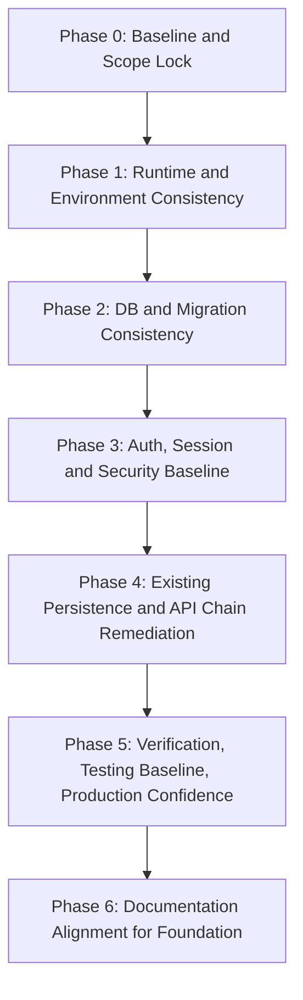

# STUBBORN RAM FOUNDATION REMEDIATION ROADMAP — 2026-09-19

## 1. Назначение документа

Этот документ определяет только текущий этап Foundation Remediation:

- стабилизация существующего технического фундамента;
- устранение подтвержденных дефектов и разрывов в уже существующих цепочках;
- без проектирования и разработки новых продуктовых модулей.

Принцип этапа:

- Если уже есть и работает правильно -> не трогаем.
- Если уже есть, но работает непредсказуемо/несогласованно -> исправляем.
- Если функциональности нет -> не создаем в рамках текущего этапа.

## 2. Источник истины

Основной источник фактов:

- PROJECT_FULL_AUDIT_2026-09-19.md (Stage 1-6).

Вспомогательные источники:

- docs/core/CODING_RULES.md
- docs/SERVER/SERVER_STATE.md
- docs/SYSTEM_STATE/SYSTEM_STATE_UPDATED_FULL.md
- docs/ARCHITECTURE/APP_STRUCTURE.md
- профильные документы по auth/training/media/storage

Правило при конфликте:

- Factual current state: code + runtime + DB evidence.
- Documentation: intended architecture.
- При конфликте без однозначного вывода: фиксируем вопрос и выносим на решение, не угадываем.

## 3. In Scope / Out Of Scope

### 3.1 In Scope (текущий этап)

1. Auth foundation:
   registration, login, session restore, logout current session, password reset, email verification, token/session lifecycle.
2. User identity and ownership в уже существующих backend routes.
3. Persistence chains в уже реализованных потоках:
   profile (что уже есть), questionnaire (coaching flow), training/workouts/exercises/materials, sessions/auth tables, existing media flow.
4. Frontend API architecture contract:
   Component -> Service -> apiClient -> Backend (в существующих модулях).
5. Backend API consistency:
   validation patterns, error contracts, predictable status behavior, SQL parameterization.
6. Local <-> Production consistency:
   env, API base URL, CORS/cookie behavior, repository vs deployed runtime, nginx/pm2/runtime composition.
7. DB and migrations consistency для уже используемого функционала, включая анализ 5918.
8. Security foundation:
   cookie/session security, CSRF implications, rate limiting coverage for existing critical routes, sensitive config handling.
9. Минимальный quality baseline для существующего фундамента:
   smoke/integration checks для auth/session/training/media flows.

### 3.2 Вне текущего scope (не разрабатывать сейчас)

1. Reports module implementation.
2. Chat module implementation.
3. Comments module implementation.
4. Notifications module implementation.
5. Programs module implementation.
6. Nutrition module implementation.
7. Полноценная Trainer/Client feature-subsystem.
8. Новые страницы и новые продуктовые сценарии.
9. Масштабные UI/UX redesign инициативы.

Примечание:

- Отсутствие пунктов из списка выше не считается defect текущего этапа.
- Классификация таких пунктов: НЕ РЕАЛИЗОВАНО / ВНЕ ТЕКУЩЕГО SCOPE.

## 4. Подтвержденная стартовая картина фундамента

1. Базовая frontend цепочка через service/apiClient в целом присутствует.
2. Подтвержденный bypass: report page делает direct backend fetch с hardcoded localhost URL.
3. Допустимое исключение: direct PUT на signed S3 URL в mediaService.
4. Auth core flows реализованы и подтверждены audit-ом.
5. Ownership checks для существующих training/media routes подтверждены.
6. Training core persistence (workouts/exercises/materials read) подтверждена.
7. Backend route для materials write существует, но frontend write path не подтвержден в текущем user-flow.
8. Repository содержит media/storage modules, production runtime composition в audit зафиксирован как mismatch.
9. Production migration state содержит divergence по 5918.
10. Security gaps по existing foundation зафиксированы: CSRF-specific protection, logout-all-devices, session cleanup.
11. Документация частично расходится с фактическим состоянием.

## 5. Foundation Defects and Risks (только по scope)

### 5.1 Confirmed Defects (исправлять в этом этапе)

| ID    | Проблема                                                                                                           | Категория                   | Priority            |
| ----- | ------------------------------------------------------------------------------------------------------------------ | --------------------------- | ------------------- |
| FD-01 | repository vs production runtime mismatch в существующем backend составе (media/storage)                           | Infrastructure/Deployment   | P0                  |
| FD-02 | migration divergence: 5918 отсутствует в production при наличии последующих миграций                               | DB/Migrations               | P0                  |
| FD-03 | report page direct backend fetch + hardcoded localhost (нарушение frontend API contract)                           | Frontend Architecture       | P0/P1 decision gate |
| FD-04 | frontend integration gap: existing backend materials write endpoint без подтвержденного frontend write flow        | Persistence/API Integration | P1                  |
| FD-05 | security baseline gaps в существующей модели auth/session (CSRF implications, logout-all-devices, session cleanup) | Security/Auth               | P0                  |
| FD-06 | test baseline для существующего фундамента отсутствует                                                             | Quality/Reliability         | P0                  |
| FD-07 | docs/runtime drift мешает предсказуемому сопровождению существующего фундамента                                    | Documentation/Operations    | P1                  |

### 5.2 Confirmed Risks (исследовать/контролировать)

1. Неполная определенность по назначению mismatch media/storage (deployment bug vs intentional non-rollout vs stale code).
2. Неполная определенность по безопасной стратегии вокруг 5918.
3. Возможные regressions при исправлении auth/session/security без автоматизированной проверки.
4. Runtime behavior under stress/outage остается ограниченно подтвержденным.

## 6. Decision Gates (обязательные точки перед изменениями)

### DG-1: Media/Storage runtime mismatch

Нужно классифицировать, что именно это означает:

1. Deployment defect existing foundation.
2. Осознанно неразвернутый слой вне текущего production foundation.
3. Устаревшая repository ветка относительно production artifact.

До решения DG-1:

- не делать автоматический вывод "срочно развернуть media/storage".

### DG-2: Migration 5918 strategy

Перед любыми миграционными действиями определить:

1. Влияет ли 5918 на уже существующие рабочие цепочки текущего этапа.
2. Почему присутствуют 5919/5920/5921 без 5918.
3. Безопасно ли применять 5918 сейчас или правильнее зафиксировать как controlled divergence.

До решения DG-2:

- не запускать 5918 автоматически.

### DG-3: Report bypass remediation priority

Проверить, влияет ли bypass на существующий фундамент текущего этапа:

1. Если влияет на единый API contract и существующие рабочие потоки -> remediation в текущем этапе.
2. Если относится к неиспользуемому/out-of-scope модулю и не ломает фундамент -> фиксируем как deferred defect.

## 7. Open Verification Items (без автоматической трактовки как bug)

| Item                                                            | Почему важно                                                      | Когда закрывать      | Блокирует ли этап                                          |
| --------------------------------------------------------------- | ----------------------------------------------------------------- | -------------------- | ---------------------------------------------------------- |
| S3 control-plane security attributes                            | Нужна доказуемость security foundation storage-слоя               | Foundation Phase 1/2 | Блокирует закрытие инфраструктурного baseline              |
| Authenticated production E2E existing media/training/auth paths | Подтверждает фактическую предсказуемость уже существующих цепочек | Foundation Phase 5   | Блокирует final sign-off                                   |
| Production stress/failure behavior для существующих flows       | Нужен reliability baseline                                        | Foundation Phase 5   | Не блокирует старт remediation, блокирует завершение этапа |
| Visibility внешних/private тестов                               | Влияет на risk-confidence                                         | Foundation Phase 0   | Не блокирует, но повышает риск                             |

## 8. Dependency Graph (Foundation Only)

## 9. Roadmap Phases (Foundation Remediation)

### Phase 0 — Baseline and Scope Lock

Цель:

- Зафиксировать, что именно является фундаментом текущего этапа и что исключено из scope.

Входное состояние:

- Завершенный audit Stage 1-6.

Задачи:

1. Утвердить In Scope / Out Of Scope список.
2. Зафиксировать confirmed defects FD-01..FD-07.
3. Зафиксировать DG-1, DG-2, DG-3 как обязательные decision points.
4. Подготовить checklist верификации существующих цепочек (auth/session/persistence/runtime).

Зависимости:

- Нет.

Затрагиваемые слои:

- Process, Docs.

Migration:

- Нет.

Production Deploy:

- Нет.

Verification:

- Согласованный foundation-only backlog.

Exit Criteria:

- Scope locked, decision gates зафиксированы, критерии проверки утверждены.

Риски:

- Размывание scope за счет попытки проектировать новые модули.

### Phase 1 — Runtime and Environment Consistency

Цель:

- Привести в согласованное состояние существующую цепочку repository <-> deployed runtime <-> environment.

Входное состояние:

- Phase 0 завершен.

Задачи:

1. Сверить deployed backend composition и repository composition по существующим фундаментальным модулям.
2. Проверить env/API base consistency local vs production для существующих цепочек.
3. Проверить CORS/cookie runtime behavior для существующих auth/session flows.
4. По DG-1 определить статус mismatch media/storage: defect/intentional/stale.
5. Зафиксировать требуемое действие по DG-1 (или defer с обоснованием).

Зависимости:

- Блокируется Phase 0.
- Блокирует финальные решения по media-related foundation behavior.

Затрагиваемые слои:

- Frontend env, Backend runtime, Nginx, PM2, deployment artifacts.

Migration:

- Нет.

Production Deploy:

- Возможно, если DG-1 подтвержден как deployment defect.

Verification:

- Runtime probes + config parity checklist.

Exit Criteria:

- Есть однозначная классификация mismatch и согласованный remediation path.

Риски:

- Неправильная интерпретация mismatch без explicit decision.

### Phase 2 — DB and Migration Consistency

Цель:

- Установить безопасно объяснимую и проверяемую DB/migration baseline для существующего функционала.

Входное состояние:

- Phase 1 завершен.

Задачи:

1. Детально разобрать 5918 и его связь с реально используемыми flows текущего этапа.
2. По DG-2 выбрать стратегию: apply/defer/alternative migration path.
3. Сверить constraints/indexes/tables, обязательные для существующих auth/training/media/session flows.
4. Уточнить local vs production schema drift только по существующему фундаменту.

Зависимости:

- Блокируется Phase 1.
- Блокирует безопасные изменения в persistence/API chain.

Затрагиваемые слои:

- PostgreSQL, migrations, backend DB layer.

Migration:

- Нужно определить (только после DG-2).

Production Deploy:

- Возможно, если выбран путь с миграциями.

Verification:

- Schema/migration consistency report по in-scope сущностям.

Exit Criteria:

- По 5918 принято и обосновано решение; DB baseline для текущего фундамента консистентен.

Риски:

- Преждевременный apply миграции без impact-анализа.

### Phase 3 — Auth, Session and Security Baseline

Цель:

- Стабилизировать существующую auth/session модель и security foundation без внедрения новых feature-сценариев.

Входное состояние:

- Phase 2 завершен.

Задачи:

1. Проверить и при необходимости исправить registration/login/session restore/logout current session flows.
2. Проверить и при необходимости исправить password reset/email verification/token lifecycle.
3. Устранить confirmed security gaps текущей модели:
   CSRF implications, session cleanup strategy.
   `logout-all-devices` не включается автоматически и рассматривается как отдельная capability вне текущего обязательного scope.
4. Подтвердить ownership checks на существующих protected data paths.
5. Зафиксировать rate-limit baseline для существующих критичных endpoint-ов.

Зависимости:

- Блокируется Phase 2.
- Блокирует final confidence существующего auth/persistence foundation.

Затрагиваемые слои:

- Backend auth/session, frontend auth state, cookies/CORS/security config.

Migration:

- Нужно определить.

Production Deploy:

- Да, вероятен.

Verification:

- Auth/session regression checklist.

Exit Criteria:

- Существующая auth/session цепочка работает предсказуемо и проверяемо.

Риски:

- Изменения в auth могут повлиять на текущие active flows без regression coverage.

### Phase 4 — Existing Persistence and API Chain Remediation

Цель:

- Закрыть разрывы только в уже существующих data/API цепочках.

Входное состояние:

- Phase 3 завершен.

Задачи:

1. Проверить и при необходимости исправить Profile/Dashboard/Questionnaire цепочки только в части уже существующей реализации.
2. Закрыть integration gap по existing training materials write path (backend route already exists).
3. По DG-3 принять решение и обработать report bypass в контексте foundation contract.
4. Привести к предсказуемости error handling path в существующих интеграциях (без массового рефакторинга ради красоты).
5. Сверить ownership validation на всех in-scope write/read paths.

Зависимости:

- Блокируется Phase 3.
- Блокирует формирование стабильного data persistence baseline.

Затрагиваемые слои:

- Frontend components/services/apiClient, backend routes/DB queries.

Migration:

- Нужно определить.

Production Deploy:

- Да, при наличии backend/frontend изменений.

Verification:

- E2E checks для существующих user-data flows.

Exit Criteria:

- Для in-scope сущностей цепочка Frontend -> Service -> apiClient -> Backend -> DB предсказуема и без известных подтвержденных разрывов.

Риски:

- Попытка расширить scope до несуществующих модулей.

### Phase 5 — Verification, Testing Baseline, Production Confidence

Цель:

- Доказать надежность уже исправленного фундамента и сформировать минимум автоматизированной проверки.

Входное состояние:

- Phase 4 завершен.

Задачи:

1. Ввести минимальный автоматизированный набор тестов для in-scope critical flows.
2. Провести local+production verification существующих цепочек.
3. Закрыть open verification items текущего этапа, где это возможно без расширения scope.
4. Зафиксировать known limitations, если item остается NOT VERIFIED.

Зависимости:

- Блокируется Phase 4.

Затрагиваемые слои:

- QA/testing layer, frontend/backend runtime validation, operational checks.

Migration:

- Нет (если не требуется дополнительный schema fix).

Production Deploy:

- Возможно.

Verification:

- Test runs + production smoke checklist.

Exit Criteria:

- Есть воспроизводимое подтверждение, что существующий фундамент работает корректно и предсказуемо.

Риски:

- Недостаточный coverage может скрыть regression.

### Phase 6 — Documentation Alignment for Foundation

Цель:

- Выравнять documentation только по итогам завершенного foundation remediation.

Входное состояние:

- Phase 5 завершен.

Задачи:

1. Обновить документацию по in-scope фундаменту, где есть подтвержденный docs/runtime drift.
2. Явно разделить: implemented vs partial vs not implemented/out of scope.
3. Зафиксировать обновленный baseline local/production consistency.

Зависимости:

- Блокируется Phase 5.

Затрагиваемые слои:

- Docs.

Migration:

- Нет.

Production Deploy:

- Нет.

Verification:

- Docs consistency pass против фактического состояния после remediation.

Exit Criteria:

- Нет критичных противоречий по foundation-секции документации.

Риски:

- Преждевременное обновление docs до завершения remediation.

## 10. Parallel vs Sequential Work

### Можно выполнять параллельно

1. Phase 0 scope-lock и подготовку verification checklists.
2. Внутри Phase 1: env consistency checks и runtime route probes.
3. Внутри Phase 3: проработка CSRF/session cleanup/logout-all-devices в одном security workstream с общими контрактами.
4. Внутри Phase 5: разработку automated checks и ручные production smoke сценарии.

### Нельзя выполнять параллельно

1. Любые миграционные действия до закрытия DG-2.
2. Любые решения по media/storage deployment до закрытия DG-1.
3. Массовые frontend изменения до решения DG-3 по report bypass.
4. Финальный docs alignment до завершения технической remediation фазы.

## 11. Deferred / Do Not Touch Yet

1. Реализация Reports/Chat/Comments/Notifications/Programs/Nutrition как новых продуктовых модулей.
2. Реализация полноценной Trainer/Client feature-subsystem.
3. Создание новых страниц и новых бизнес-сценариев.
4. Большой рефакторинг существующего кода без подтвержденного defect/impact на foundation.

## 12. Definition of Done (текущий этап)

Foundation Remediation считается завершенным, когда:

1. Существующие auth/session flows согласованы и предсказуемы.
2. User identity и ownership checks по существующим data paths корректны.
3. Existing persistence chains (profile/dashboard/questionnaire/training/materials/session) не имеют подтвержденных разрывов по in-scope функционалу.
4. Local and production архитектурно согласованы в рамках существующих модулей.
5. Repository and deployed runtime не имеют необъясненных mismatch по in-scope foundation.
6. Migration/schema baseline для существующего функционала понятен и безопасно объяснен (включая решение по 5918).
7. Security baseline issues текущей модели закрыты или формально приняты как known limitations.
8. Есть минимальный воспроизводимый verification/test baseline.
9. Out-of-scope модули остаются явно отмеченными как НЕ РЕАЛИЗОВАНО / ВНЕ ТЕКУЩЕГО SCOPE без попытки их реализовать.

## 13. Final Foundation Sequence

ТЕКУЩЕЕ СОСТОЯНИЕ FOUNDATION

- Есть рабочее ядро auth/training/session, но есть confirmed inconsistencies и verification gaps.

↓

PHASE 0

- Причина: зафиксировать границы и не уйти в разработку новых модулей.

↓

PHASE 1

- Причина: без runtime/env консистентности нельзя достоверно оценить остальной фундамент.

↓

PHASE 2

- Причина: DB/migration baseline должен быть объяснимым до любых persistence-изменений.

↓

PHASE 3

- Причина: auth/session/security foundation критичен для всех in-scope цепочек.

↓

PHASE 4

- Причина: закрытие существующих API/persistence разрывов в уже реализованных потоках.

↓

PHASE 5

- Причина: подтверждение надежности через проверку и минимальный automated baseline.

↓

PHASE 6

- Причина: документация фиксируется только после фактической стабилизации foundation.

## 14. Архитектурные вопросы, требующие ручного решения

1. DG-1: media/storage mismatch classification и действие.
2. DG-2: стратегия по migration 5918.
3. DG-3: приоритет remediation report bypass в рамках текущего scope.

Шаблон реакции:

- Обнаружен архитектурный вопрос, который нельзя безопасно решить автоматически.
- Фиксируются факты, конфликт, варианты, и запрашивается решение до внесения изменений.

## 15. Что НЕ подтверждено аудитом

1. S3 control-plane security attributes.
2. Полный authenticated production E2E existing media/report behavior в non-mutating условиях.
3. Полный production stress/failure baseline.
4. Visibility внешних/private test suites.

Ограничение:

- Это verification gaps, а не автоматические дефекты.

## 16. Phase 1 Normalized Backlog

Принятые решения перед нормализацией:

1. DG-2: `5918` = `CONTROLLED DIVERGENCE` (не применять в текущем этапе).
2. DG-1: `FIXED — VERIFIED`; controlled deployment выполнен, runtime composition local/prod выровнен.
3. DG-3: report bypass остаётся `DEFERRED` до отдельного решения, не входит в первую волну implementation.

### A. CONFIRMED REMEDIATION

| ID        | Problem                                                 | Existing chain                                       | Minimal remediation scope                                                                | Status                    |
| --------- | ------------------------------------------------------- | ---------------------------------------------------- | ---------------------------------------------------------------------------------------- | ------------------------- |
| F1-PST-01 | Training materials write integration gap                | `Component -> Service -> apiClient -> Backend -> DB` | Добавить отсутствующий write-path в существующую цепочку без расширения функциональности | FIXED — VERIFIED          |
| F1-PST-02 | Materials write error/ownership integration consistency | Existing training materials PUT/GET chain            | Нормализовать обработку подтверждённых ответов backend для существующего flow            | VERIFIED (NO CODE CHANGE) |

### B. VERIFICATION

| ID        | Problem                                      | What is verified                                                                        | Why                                                 | Status                    |
| --------- | -------------------------------------------- | --------------------------------------------------------------------------------------- | --------------------------------------------------- | ------------------------- |
| F1-API-01 | In-scope API contract verification           | Проверка отсутствия direct-backend bypass в in-scope flows (кроме report deferred zone) | Зафиксировать чистый baseline перед изменениями     | VERIFIED (NO CODE CHANGE) |
| F1-ENV-01 | Local/production consistency checklist       | API base URL, CORS, cookies, env, runtime composition для in-scope flows                | Устранить ложные причины дефектов до фиксов         | FIXED — VERIFIED          |
| F1-TST-01 | Minimal auth/session smoke baseline          | registration/login/session restore/logout/password reset/email verification             | Нужен повторяемый контроль существующего фундамента | READY                     |
| F1-TST-02 | Minimal persistence/ownership smoke baseline | workout persistence, ownership rejections, materials GET/PUT                            | Проверка целостности существующих data chains       | READY                     |

### C. NEEDS USER DECISION

| ID        | Problem                             | Decision required                                                                    | Why                                                                                               | Status              |
| --------- | ----------------------------------- | ------------------------------------------------------------------------------------ | ------------------------------------------------------------------------------------------------- | ------------------- |
| F1-SEC-02 | CSRF baseline for cookie-auth       | Выбор минимальной remediation-модели CSRF для текущего этапа                         | Без policy-решения риск сломать существующие state-changing flows                                 | NEEDS USER DECISION |
| F1-SEC-03 | Session cleanup baseline            | Выбор минимальной cleanup-стратегии (обязательная/accepted limitation)               | Нужна граница между security limitation и обязательной реализацией этапа                          | NEEDS USER DECISION |
| F1-SEC-01 | Registration + email-send ambiguity | Классификация: defect текущего контракта или допустимая UX ambiguity с recovery path | Пользователь создаётся до отправки email; при send-fail нужен policy-вердикт по expected behavior | NEEDS USER DECISION |

### D. DEFERRED / OUT OF CURRENT SCOPE

| ID              | Problem                                       | Reason                                                                                                                                                   | Status               |
| --------------- | --------------------------------------------- | -------------------------------------------------------------------------------------------------------------------------------------------------------- | -------------------- |
| F1-API-02       | Report direct-fetch bypass remediation        | Report модуль out-of-scope текущей фазы; исправление отложено до отдельного решения DG-3                                                                 | NOT IN CURRENT SCOPE |
| F1-SEC-04       | Logout-all-devices                            | Новая capability, не обязательный дефект current-session foundation                                                                                      | NOT IN CURRENT SCOPE |
| F1-MEDIA-DEPLOY | Media/storage production deployment alignment | DG-1 closure: controlled rollout выполнен; media/storage присутствуют в production runtime, route `/api/media/upload` отвечает 401 (защищённый endpoint) | FIXED — VERIFIED     |

### E. NOT VERIFIED

| ID       | Item                                    | Missing evidence                                                                      | Status       |
| -------- | --------------------------------------- | ------------------------------------------------------------------------------------- | ------------ |
| F1-NV-01 | S3 control-plane security attributes    | Нет authenticated runtime evidence policy/ACL/public-access/lifecycle/cors/encryption | NOT VERIFIED |
| F1-NV-02 | Full production stress/failure baseline | Нет завершённого stress/failure verification для in-scope runtime flows               | NOT VERIFIED |
| F1-NV-03 | External/private tests visibility       | Нет доказательств внешних test suites вне repository                                  | NOT VERIFIED |

### F1-SEC-01 Recheck (нормализация)

Переоценка по фактам кода и audit:

1. Пользователь и профиль создаются в транзакции, затем `COMMIT`.
2. После коммита создаётся verification token и вызывается отправка email.
3. При ошибке отправки email frontend получает ошибку, хотя user уже создан.
4. Recovery path существует: повторная регистрация даёт `EMAIL_ALREADY_EXISTS`; endpoint resend verification доступен.

Итог классификации в текущем backlog:

- `NEEDS USER DECISION` (не фиксируется автоматически как confirmed defect).
- Текущий статус: подтверждённая UX ambiguity с существующим recovery path.

### F1-PST-01 Recheck (подтверждение кандидата на первое исправление)

Подтверждённая цепочка и разрыв:

1. Backend: `PUT /api/training/sets/:setId/materials` существует и содержит ownership + DB persistence.
2. Frontend service: есть только `getSetMaterials` (GET), write-метод отсутствует.
3. UI: текущая карточка тренировки загружает материалы, но не имеет подтверждённого persist write path через service/apiClient.
4. Исправление возможно минимально в существующем модуле без создания нового feature-модуля.

Итог:

- `CONFIRMED REMEDIATION — READY`.
- 2026-09-19 update: `IMPLEMENTED — NOT YET VERIFIED` (code path added, full runtime verification pending).
- 2026-09-19 runtime verification: `FIXED — VERIFIED` (PUT/GET/reload persistence и ownership denial подтверждены в runtime).

## FOUNDATION REMEDIATION CLOSURE — 2026-09-19

Статус этапа: COMPLETED WITH DOCUMENTED LIMITATIONS

Closed items:

1. F1-PST-01 — FIXED — VERIFIED: training materials write path added and runtime-confirmed.
   - Scope confirmation: LOCALHOST + PRODUCTION.
   - Limitation: none recorded for the final runtime path.
2. F1-PST-02 — VERIFIED (NO CODE CHANGE): materials write error/ownership consistency normalized in the existing flow.
   - Scope confirmation: LOCALHOST.
   - Limitation: verified without code change.
3. F1-API-01 — VERIFIED (NO CODE CHANGE): in-scope API contract baseline confirmed.
   - Scope confirmation: LOCALHOST.
   - Limitation: report direct-fetch zone remains out of current scope.
4. F1-ENV-01 — FIXED — VERIFIED: local/production consistency baseline aligned for in-scope flows.
   - Scope confirmation: LOCALHOST + PRODUCTION.
   - Limitation: production/runtime alignment is limited to the in-scope foundation surface.
5. F1-MEDIA-DEPLOY — FIXED — VERIFIED: media/storage runtime alignment restored and protected endpoint confirmed.
   - Scope confirmation: PRODUCTION.
   - Limitation: S3 control-plane audit details remain outside this closure scope.
6. F1-NV-01 — FIXED — VERIFIED: production object storage security behavior and private flow confirmed.
   - Scope confirmation: PRODUCTION.
   - Limitation: provider control-plane API coverage is not uniformly available.
7. F1-NV-02 — VERIFIED: production stress/failure baseline was not treated as an open defect after the verification pass.
   - Scope confirmation: PRODUCTION.
   - Limitation: automated stress coverage remains outside the closure scope.
8. F1-NV-03 — VERIFIED: external/private test visibility gap remained documented as an evidence gap, not a runtime defect.
   - Scope confirmation: PRODUCTION.
   - Limitation: visibility into external/private suites is still not provided by the repository.
9. F1-SEC-02 — FIXED — VERIFIED: CSRF/origin baseline for cookie-auth confirmed.
   - Scope confirmation: LOCALHOST + PRODUCTION.
   - Limitation: no broader CSRF token enhancement was added in this stage.
10. F1-SEC-03 — FIXED — VERIFIED: session cleanup baseline confirmed with startup/periodic housekeeping.
    - Scope confirmation: LOCALHOST + PRODUCTION.
    - Limitation: cleanup strategy is intentionally minimal and stays within current auth/session semantics.

Partially verified / not fully verified items:

1. F1-SEC-01 — production verification is PARTIALLY VERIFIED.
   - What was confirmed: registration success path and resend verification in PRODUCTION; implementation and recovery path in LOCALHOST.
   - What was not reproduced: the production email-failure scenario.
   - Limitation: safe-policy prevented intentionally breaking the provider/config path.

Deferred items:

1. F1-API-02 — report direct-fetch bypass remediation remains NOT IN CURRENT SCOPE.
2. F1-SEC-04 — logout-all-devices remains NOT IN CURRENT SCOPE.
3. CSRF token enhancement remains DEFERRED/FUTURE as the broader hardening extension beyond the current minimal baseline.
4. pgAdmin 2FA/MFA remains DEFERRED/FUTURE.

Blocked items:

1. No current Foundation items remain BLOCKED in the final closure state.
2. Historical BLOCKED entries in the log were superseded by later VERIFIED / FIXED — VERIFIED evidence.

Foundation summary:

1. The auth/session/training/materials baseline is now functionally stable for the current foundation scope.
2. The production/admin infrastructure subset and the production object-storage path are confirmed as working baselines.
3. The remaining open items are deliberate deferrals or partial-verification boundaries, not unresolved core foundation breakage.
4. This closure does not expand scope into Reports, Chat, or other new product modules.

Next phase according to the current roadmap:

1. Phase 6 — Documentation Alignment for Foundation is the final named foundation phase in the roadmap.
2. The roadmap does not name a further foundation phase beyond Phase 6.
3. After Foundation Remediation closure, further product-development work continues under the main project roadmap, not as a continuation of Foundation Remediation.
